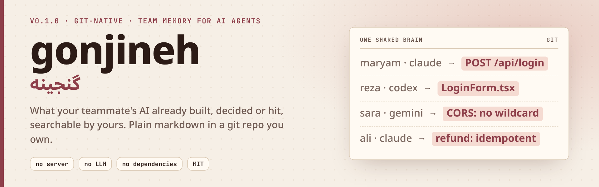

<div align="center">

<picture>
  <source media="(prefers-color-scheme: dark)" srcset="assets/banner-dark.png">
  
</picture>

<div dir="rtl">

[English](README.md) · **فارسی** · [🌐 نمونه‌ی زنده](https://mrzroot.github.io/ganjineh/) · [📦 انتشار نسخه‌ی ۰٫۱٫۲](https://github.com/mrzroot/ganjineh/releases/tag/v0.1.2) · [🗒 تغییرات](CHANGELOG.md)

</div>

      

</div>

<div dir="rtl">

> **در یک جمله:** وقتی شما و هم‌تیمی‌تان هر کدام یک دستیار هوش مصنوعی روی یک پروژه دارید، این دو دستیار از کارِ هم خبر ندارند. **گنجینه (ganjineh)** یک دفترچه‌ی مشترک تیمی است که هوش مصنوعی‌ها خودشان در آن می‌نویسند و از آن می‌خوانند؛ تا هوش مصنوعیِ یک نفر کاری را که هوش مصنوعیِ نفر دیگر انجام داده، دوباره نسازد یا خلافش را پیشنهاد ندهد.
>
> **یک مثال روزمره:** دو آشپز در یک آشپزخانه‌اند و با هم حرف نمی‌زنند. یکی نان می‌پزد، یک ساعت بعد آن یکی دوباره نان می‌پزد. یک دفترچه به دیوار بزنید: «نان: پخته شد، ۳ تا». حالا آشپز دوم اول نگاه می‌کند. گنجینه همین دفترچه‌ی دیوار است، برای دستیارهای هوش مصنوعی.
>
> نام درست آن «گَنجینه» است (به لاتین ganjineh). دفترچه فقط یک پوشه از فایل‌های متنیِ کوچک در یک مخزن git است که مال خودتان است (git ابزاری است که بیشتر برنامه‌نویس‌ها برای به‌اشتراک‌گذاشتن کد دارند). نه سرور می‌خواهد، نه حساب کاربری، نه هزینه‌ی اضافه‌ی هوش مصنوعی.

**فهرست:** [چرا](#-چرا) · [نصب](#-نصب) · [شروع سریع](#-شروع-سریع) · [خروجی واقعی](#-خروجی-واقعی) · [راه‌اندازی برای هر ابزار](#-راهاندازی-برای-هر-ابزار) · [چگونه کار می‌کند](#-چگونه-کار-میکند) · [حریم خصوصی](#-حریم-خصوصی-و-پاکساز) · [محدودیت‌ها](#-محدودیتها-و-صداقت) · [جایگزین‌ها](#-جایگزینها) · [نقشه‌ی راه](#-نقشهی-راه) · [مشارکت](#-مشارکت) · [مجوز](#-مجوز)

## 🎯 چرا

فرض کنید شما و تیمتان برای برنامه‌نویسی از دستیار هوش مصنوعی استفاده می‌کنید. یکی روی بخشی کار می‌کند که کاربر می‌بیند (فرانت)، یکی روی بخش پشت صحنه (بکند). هوش مصنوعیِ هر نفر فقط گفتگوهای خودش را به یاد دارد. پس هوش مصنوعیِ فرانت یک سرویس ورودِ ساختگی می‌سازد در حالی که نمونه‌ی واقعی‌اش از قبل هست، یا کاری را پیشنهاد می‌دهد که نفر بکند همین الان تصمیم گرفته انجام ندهد.

`ganjineh` این گفتگوها را به **یک دفترچه‌ی مشترک تبدیل می‌کند که هوش مصنوعیِ همه‌ی تیم می‌تواند در آن جست‌وجو کند**:

- **خودکار.** وقتی یک جلسه‌ی هوش مصنوعی تمام می‌شود، یک برنامه‌ی کوچک کمکی («hook»: برنامه‌ای که ابزار هوش مصنوعی در لحظه‌های مشخص خودش اجرا می‌کند) یک یادداشت کوتاه می‌نویسد. کسی لازم نیست یادش بماند. اگر خواستید می‌توانید با `ganjineh note` دستی هم یادداشت بگذارید.
- **با git مشترک می‌شود.** هر جلسه یک فایل کوچک است و فقط نویسنده‌اش آن را می‌نویسد؛ پس کسی روی کار دیگری نمی‌نویسد. تیم شما همین حالا هم git دارد، پس چیز تازه‌ای برای راه‌اندازی یا پرداخت نیست.
- **بدون هوش مصنوعیِ اضافه.** یادداشت‌ها با قاعده‌های ساده ساخته می‌شوند، نه با یک هوش مصنوعیِ دیگر. پس هزینه‌ی اضافه ندارد و گفتگوهای شما برای کسی تازه فرستاده نمی‌شود.
- **اول رمزها پاک می‌شوند.** رمز، کلید، شماره‌کارت و شماره‌ی موبایل ایرانی *پیش از هر ذخیره‌ای* با `[REDACTED]` جایگزین می‌شوند. این بخش برای رمزها خاموش‌شدنی نیست.
- **فارسی را می‌فهمد.** جستجو شکل‌های مختلف نوشتن ی/ک، نیم‌فاصله و ارقام فارسی را یکسان می‌گیرد؛ پس «ورود» و «login» هر دو یادداشتِ درست را پیدا می‌کنند.

## 📦 نصب

پایتون ۳٫۹ به بالا و فقط کتابخانه‌ی استاندارد. هنوز روی PyPI نیست:

</div>

```sh
pipx install git+https://github.com/mrzroot/ganjineh     # یا: pip install git+https://github.com/mrzroot/ganjineh
ganjineh --help
```

<div dir="rtl">

## 🚀 شروع سریع

یک مخزن خصوصی خالی برای «مغز تیم» بسازید (هر میزبان git: GitHub، GitLab یا یک bare repo روی سرور مشترک). سپس **هر هم‌تیمی یک بار** داخل پوشه‌ی پروژه:

</div>

```sh
ganjineh init --brain git@github.com:your-team/team-brain.git --area backend    # --codex هم Codex را وصل می‌کند (تنظیم سطح کاربر)
git add .ganjineh.json CLAUDE.md AGENTS.md GEMINI.md .github .cursor .mcp.json .gemini .vscode .claude/settings.json
git commit -m "Add ganjineh" && git push
```

<div dir="rtl">

بقیه‌ی اعضا آن commit را می‌گیرند و `ganjineh init --area frontend` را اجرا می‌کنند (area مخصوص خودشان؛ نشانی مغز از `.ganjineh.json` خوانده می‌شود). از آن به بعد:

۱. **شروع جلسه:** عامل با کارهای اخیر هم‌تیمی‌ها توجیه می‌شود.
۲. **هر پرامپت:** اگر یادداشت‌های هم‌تیمی‌ها با آن بخوانند، تا ۳ مورد به متن اضافه می‌شود (هرگز یادداشت‌های خودتان نه).
۳. **پایان جلسه یا فشرده‌سازی:** گفتگو خلاصه، پاک‌سازی، commit و در پس‌زمینه push می‌شود.

دستی هم می‌شود: `ganjineh search "refund screen"`، `ganjineh who server/routes/auth.py`، `ganjineh recall`، `ganjineh show <id>`، `ganjineh doctor`، `ganjineh uninstall`.

## 🎬 خروجی واقعی

تولیدشده با [`examples/demo.py`](examples/demo.py) (دو هم‌تیمی، یک bare repo محلی، بدون شبکه)؛ متن کامل در [`docs/demo.txt`](docs/demo.txt). گزیده:

</div>

```text
[reza] $ ganjineh search --pull refund screen
[7b88d6deca] 2026-03-02 maryam (claude-code) · backend · Add a refund endpoint for orders. Use POST /api/orders/refund …  (score 3.194)
    files: server/routes/refunds.py, server/models/refund.py
    api:   POST /api/orders/refund
    decision: We decided to store only the last four digits because PCI scope is out of budget.

[reza] $ ganjineh search ورود login
[d737c50590] 2026-03-02 maryam (claude-code) · backend · ایجاد API ورود با ایمیل و رمز: POST /api/login  (score 2.753)
    decision: تصمیم گرفتیم توکن JWT را در کوکی httpOnly بگذاریم چون ذخیره در localStorage امن نیست.

sk_live in git history: False  |  commits: 2      # the fake key in maryam's chat was masked first
```

<div dir="rtl">

یادداشت ذخیره‌شده مارک‌داونِ ساده با یک front-matter کوچک از نوع JSON است؛ می‌توانید مثل هر فایل دیگری بخوانید، `grep` کنید و در pull request مرور کنید.

## 🧩 راه‌اندازی برای هر ابزار

`ganjineh init` چه می‌نویسد، و **هر ابزار واقعاً تا کجا آزموده شده** (جزئیات در [docs/VERIFICATION.md](docs/VERIFICATION.md)):

| ابزار | ثبت (نوشتن) | بازیابی (خواندن) | چگونه آزموده شد |
|---|---|---|---|
| **Claude Code** | hook های `SessionStart`، `UserPromptSubmit`، `Stop`، `SessionEnd`، `PreCompact` در `.claude/settings.json` | توجیه + تزریق برای هر پرامپت + MCP | CLI واقعیِ ۲٫۱٫۱۹۷ روی **API ساختگی**: گفتگو ثبت شد و توجیه و یادداشت‌های هم‌تیمی در بدنه‌ی درخواست دیده شد |
| **Codex** | hook از نوع `notify` (سطح کاربر در `~/.codex/config.toml` با `init --codex`)، خواندن rollout از `~/.codex/sessions` | سرور MCP + `AGENTS.md` | CLI واقعیِ ۰٫۱۶۴٫۰ روی **API ساختگی**: notify همان rollout واقعی را ثبت کرد و ابزار MCP فهرست شد |
| **Gemini CLI** | `ganjineh capture --format gemini` (بدون hook؛ تجزیه‌گر در حد تلاش) | MCP + `GEMINI.md` | CLI واقعیِ ۰٫۶۵٫۰: `mcp list` وضعیت **Connected** نشان می‌دهد. تجزیه‌گر روی فایل‌های واقعی **آزموده نشده** |
| **Cursor** | `ganjineh note` / ابزار MCP `add_note` | `.cursor/mcp.json` + `.cursor/rules` | فقط فایل‌های پیکربندی، **اجرا نشده** |
| **Copilot (VS Code)** | `ganjineh note` | `.vscode/mcp.json` + `copilot-instructions.md` | فقط فایل‌های پیکربندی، **اجرا نشده** |
| هر کلاینت MCP دیگر | ابزار `add_note` | `search_memory`، `read_entry`، `who_knows_about`، `recent` | پروتکل MCP روی stdio در تست‌های واحد آزموده شد |

> ⚠️ هیچ جلسه‌ی زنده‌ای با مدل واقعی و کلید API واقعی اجرا نشده است. CLI های واقعی روی API ساختگی اجرا شدند؛ این لوله‌کشی را ثابت می‌کند (hook اجرا می‌شود، فایل نوشته می‌شود، متن به درخواست می‌رسد) ولی نه اینکه مدل واقعی چقدر از آن متن استفاده می‌کند.

## ⚙️ چگونه کار می‌کند

</div>

```
 hook کلود/کدکس ─▶ تجزیه‌ی گفتگو ─▶ خلاصه (قاعده‌محور) ─▶ پاک‌سازی ─▶ entries/<project>/<area>/<date>-<author>-<tool>-<id>.md
                                                                              │ git commit، fetch، rebase، push (با تلاش مجدد)
                                                                              ▼
 پرامپت ─▶ BM25 روی مارک‌داون محلی (+ who-knows) ◀─ git pull ◀──────── مخزن team-brain شما
```

<div dir="rtl">

- **خلاصه‌سازی.** قاعده‌ها استخراج می‌کنند: چه خواسته شد، نتیجه، جمله‌های دارای نشانه‌ی تصمیم/دردسر (انگلیسی و فارسی)، کارهای باقی‌مانده، فایل‌های دست‌خورده، اندپوینت‌ها و دستورها. area (frontend / backend / infra / docs) از الگوی مسیر فایل‌ها می‌آید و در `.ganjineh.json` قابل تغییر است.
- **ذخیره.** یک فایل مارک‌داون برای هر جلسه که فقط نویسنده‌اش می‌نویسد؛ پس push های همزمان تداخل ندارند. ثبت دوباره‌ی همان جلسه فایل خودش را بازنویسی می‌کند. `INDEX.md` محلی ساخته و git-ignore می‌شود.
- **جستجو.** BM25 با وزن فیلدها، گسترش پیشوندی و نرمال‌سازی فارسی. بدون embedding، بدون daemon، بدون پایگاه‌داده. روی مجموعه‌ی کوچک امتیاز BM25 ریز است؛ پس hook ی هر پرامپت یک دروازه دارد: آستانه‌ی امتیاز *یا* دست‌کم دو واژه‌ی متمایز از پرسش در یادداشت.
- **همگام‌سازی.** commit، fetch، `rebase origin/<branch>`، push و تا ۴ بار تلاش مجدد. آفلاین هم مشکلی نیست: یادداشت‌ها محلی می‌مانند و در همگام‌سازی بعدی می‌روند. Codex در هر نوبت `notify` می‌زند؛ پس push آن ۴۵ ثانیه debounce می‌شود.
- **MCP.** `ganjineh mcp` یک سرور JSON-RPC روی stdio است: `search_memory`، `read_entry`، `add_note`، `who_knows_about`، `recent`.

## 🔒 حریم خصوصی و پاک‌ساز

پاک‌سازی روی همه‌ی فیلدها **پیش از هر نوشتن** اجرا می‌شود؛ پس رمزها هرگز به تاریخچه‌ی git نمی‌رسند.

- **همیشه ماسک می‌شود:** توکن‌های AWS، GitHub، GitLab، Slack، Stripe، Anthropic، OpenAI، Google، npm، SendGrid، Twilio، Telegram، JWT، کلید خصوصی، URL های دارای `user:pass@`، `Bearer …`، انتساب‌هایی مثل `password=` یا `secret=`، رشته‌های طولانیِ پرآنتروپی، و شماره‌کارت معتبر طبق Luhn (ارقام لاتین یا فارسی).
- **اطلاعات شخصی (به‌طور پیش‌فرض روشن؛ برای شل‌کردن در `.ganjineh.json` مقدار `"pii": false`):** موبایل ایرانی. **ایمیل ماسک نمی‌شود مگر `"mask_email": true` بگذارید.**
- **کنارگذاشتن یک جلسه:** در پرامپت `#private` یا `ganjineh:off` یا `#نهان` بنویسید؛ آن جلسه کلاً رد می‌شود.
- **کنارگذاشتن فایل‌ها:** `.ganjinehignore` (سبک gitignore؛ نام قدیمی‌تر `.brainignore` هم کار می‌کند) مسیرهای منطبق را از یادداشت‌ها حذف می‌کند.
- **مخزن شما، کنترل دسترسی شما.** مخزن مغز را خصوصی بگیرید. یادداشت‌ها کد و تصمیم‌های شما را توصیف می‌کنند؛ دسترسی خواندن را مثل دسترسی خواندن به کد در نظر بگیرید.

پاک‌ساز الگو‌محور است و رمزهای با شکل غیرمعمول را از دست می‌دهد. تنها کنترل خود نکنید؛ بخش بعد را ببینید.

## ⚖️ محدودیت‌ها و صداقت

- **خلاصه‌ساز قاعده‌محور است، نه فهمنده.** استخراج و نقل می‌کند. بعضی یادداشت‌ها پرنویز خواهند بود یا اصل مطلب را از دست می‌دهند. پیش از اعتماد، با `ganjineh show <id>` بخوانید.
- **جستجو واژه‌ای است.** BM25 مترادف‌هایی را که واژه‌ی مشترک ندارند پیدا نمی‌کند.
- **پاک‌سازی در حد تلاش است.** همه‌ی رمزها و جزئیات شخصی را نمی‌گیرد و هر چه هم‌تیمی‌تان تایپ کند برای کل تیم دیده می‌شود.
- **راستی‌آزمایی ناقص است.** جدول بالا و [docs/VERIFICATION.md](docs/VERIFICATION.md). آزموده نشده: مدل زنده با کلید واقعی، ویندوز، macOS، remote واقعی GitHub (از bare repo محلی استفاده شد)، رفتار Cursor و Copilot، فایل‌های واقعی گفتگوی Gemini.
- **تنظیمات Codex سطح کاربر است:** `init --codex` فایل `~/.codex/config.toml` را در یک بلوک علامت‌دار ویرایش می‌کند (`uninstall --codex` پاکش می‌کند). hook های Claude سطح پروژه‌اند و commit می‌شوند.
- **تأییدها:** در Claude Code سرور MCP سطح پروژه تأیید شما را می‌خواهد؛ Gemini پوشه‌ی مورد اعتماد می‌خواهد.
- **هنوز CI ندارد.** توکنی که این مخزن با آن منتشر شد دسترسی GitHub Actions (workflow) نداشت؛ پس `.github/workflows` وجود ندارد. تست‌ها را محلی اجرا کنید: `pip install pytest && PYTHONPATH=src pytest tests`.
- **پروژه‌ی تازه (۰٫۱٫۰).** پیش از ۱٫۰ انتظار ناهمواری و تغییر قالب داشته باشید.

## 🔍 جایگزین‌ها

این حوزه شلوغ است و چند پروژه‌ی خوب دارد. **اگر یکی به کارتان می‌آید، از آن استفاده کنید.** نقشه‌ای ناکامل از جستجوی ۳ آبان ۱۴۰۵ (۲۰۲۶-۱۰-۲۵)؛ جزئیات و ملاحظات در [NOVELTY.md](NOVELTY.md):

| پروژه | شکل | تفاوت با ganjineh |
|---|---|---|
| **gitmem** (dev-boz) | حافظه‌ی تیمیِ همگام با git | نزدیک‌ترین؛ تفاوت‌ها و جاهایی که شاید برای شما بهتر باشد در NOVELTY.md |
| **team-memory** (blain3white)، **ai-memory** (akitaonrails) | حافظه‌ی مشترک عامل‌ها | انتخاب‌های متفاوت ذخیره و بازیابی |
| **TeamBrain**، **Krimto**، **Knowit**، **CrewMemory**، **Commonwealth** | حافظه‌ی تیمی/مشترک، گوناگون | چند مورد میزبانی‌شده‌اند یا سرور یا LLM دارند |
| **claude-mem-sync** | همگام‌سازی claude-mem بین دستگاه‌ها | روی ذخیره‌ی محلی دیگری بنا شده |
| **iHow Memory**، **mex** | ابزار حافظه / زمینه‌ی پروژه | هدف متفاوت (شخصی یا scaffold زمینه) |

شرط‌بندی `ganjineh`: **ثبت منفعل با hook ← خلاصه‌ی بدون LLM ← پاک‌ساز اجباری ← مارک‌داون ساده در git ← BM25 محلی**، در یک بسته‌ی پایتونِ فقط‌-stdlib که فارسی را شهروند درجه‌یک می‌داند. اگر embedding، رابط وب، همگام‌سازی میزبانی‌شده یا خلاصه‌ی نوشته‌ی LLM می‌خواهید، عمداً این‌ها را ندارد.

## 🗺️ نقشه‌ی راه

- آزمون با جلسه‌های زنده و remote واقعی GitHub و انتشار نتیجه.
- تجزیه‌گر واقعی گفتگوی Gemini پس از تأیید قالب، و ثبت برای Cursor/Copilot.
- `ganjineh prune` / نگهداری محدود، و خروجی HTML ایستا و فقط‌خواندنی از مغز.
- خلاصه‌ی اختیاری با LLM (پیش‌فرض خاموش، کلید خودتان)، فقط اگر پاک‌ساز جلوتر از آن بماند.
- انتشار روی PyPI و CI، وقتی توکن انتشار اجازه‌ی workflow بدهد.

## 🤝 مشارکت

PR های کوچک و صادقانه خوش‌آمدند: رمزهایی که پاک‌ساز از دست می‌دهد، قالب گفتگوی ابزارهای دیگر، خطاهای خلاصه‌ساز. [CONTRIBUTING.md](CONTRIBUTING.md) را ببینید. لطفاً هرگز رمز واقعی در issue نگذارید.

## 📄 مجوز

MIT © محمدرضا زارع. [LICENSE](LICENSE). برای ارجاع، [CITATION.cff](CITATION.cff) را ببینید.

</div>
